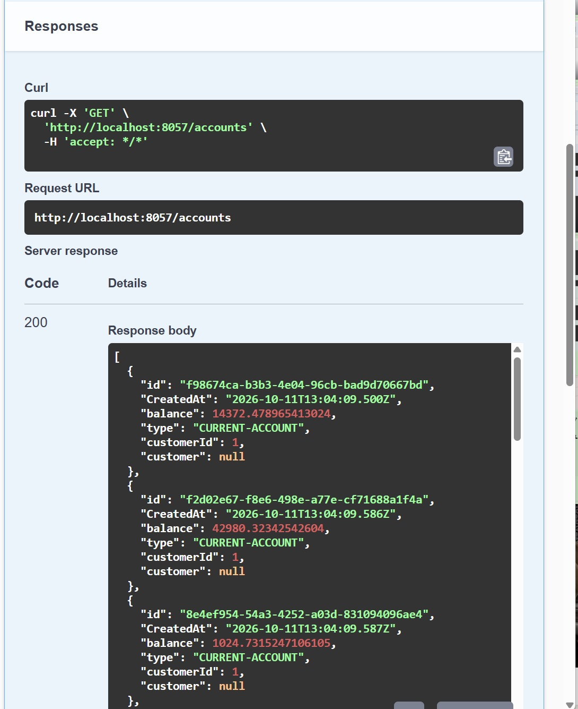
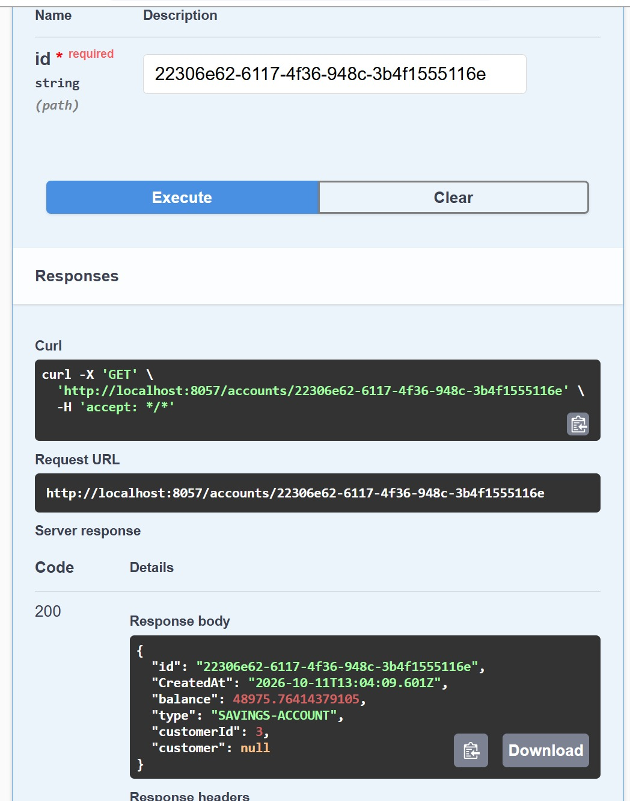
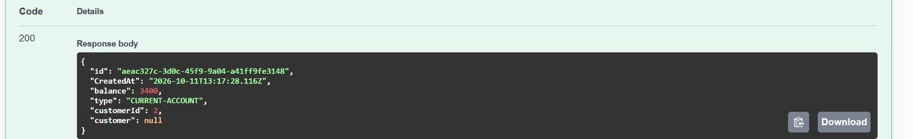
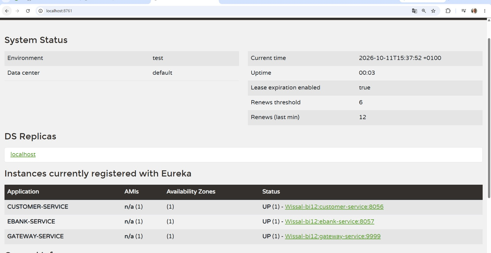
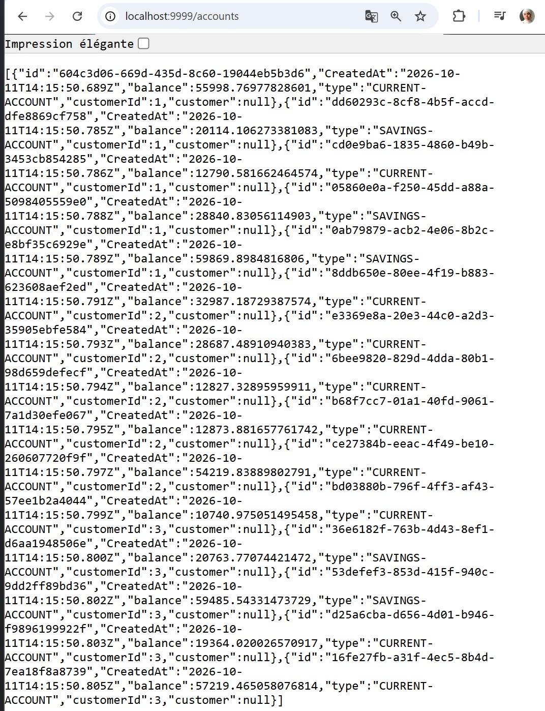
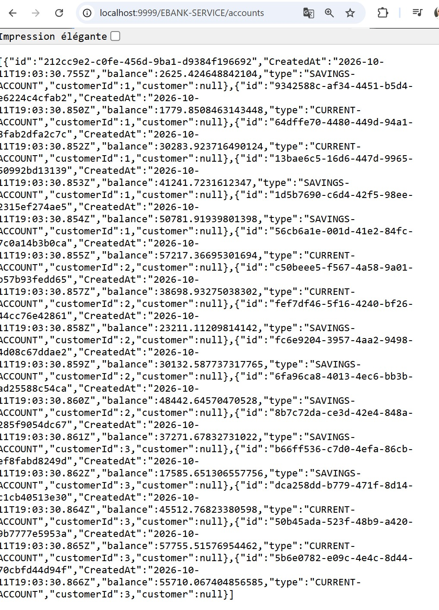
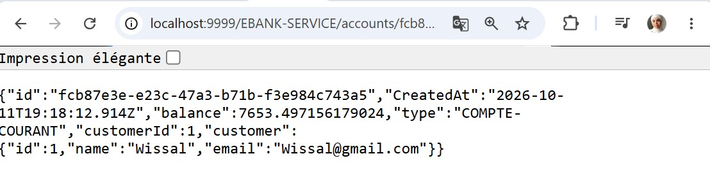
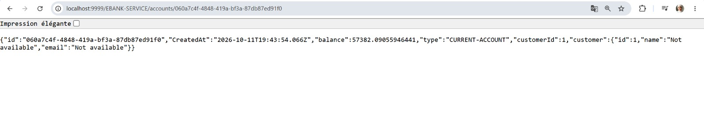

# Rapport de Projet : Architecture Microservices avec Spring Cloud, Spring AI, MCP et Angular

## 1. Introduction
Dans le contexte actuel de la transformation numérique, les applications monolithiques présentent plusieurs limites en matière de scalabilité, de maintenance et de déploiement. L'architecture microservices constitue une solution moderne permettant de découper une application en plusieurs services indépendants, communicant entre eux via des API.

La vidéo *Part 1 - La Totale Architectures Micro-services - Spring Cloud - Spring AI - MCP - Angular* présente la mise en œuvre complète d'un système bancaire basé sur les microservices avec l'écosystème Spring Cloud.

## 2. Problématique
Comment concevoir une application bancaire :
*   Modulaire et évolutive ;
*   Facile à maintenir ;
*   Tolérante aux pannes ;
*   Capable d'intégrer des services d'intelligence artificielle ;
*   Accessible à travers une interface web moderne.

Les applications monolithiques deviennent rapidement difficiles à maintenir lorsque le nombre d'utilisateurs et de fonctionnalités augmente. Il est donc nécessaire de mettre en place une architecture distribuée permettant l'indépendance des services tout en garantissant leur collaboration.

## 3. Solution Proposée
La solution consiste à développer une plateforme bancaire basée sur une architecture microservices utilisant la stack technologique suivante : Spring Boot, Spring Cloud, Eureka Discovery Server, Spring Cloud Gateway, OpenFeign, Resilience4J, Spring AI, MCP (Model Context Protocol), et Angular.

## 4. Architecture Générale du Système

```text
                    +----------------+
                    |   Utilisateur  |
                    +--------+-------+
                             |
                             v
                    +----------------+
                    | API Gateway    |
                    +--------+-------+
                             |
             +---------------+---------------+
             |                               |
             v                               v
 +---------------------+       +----------------------+
 | Customer Service    |       | EBank Service        |
 | Gestion Clients     |       | Gestion Comptes      |
 +----------+----------+       +----------+-----------+
            |                             |
            +-------------+---------------+
                          |
                          v
                +--------------------+
                | Eureka Discovery   |
                | Server             |
                +--------------------+
```

## 5. Description des Composants et Preuves de Fonctionnement

### 5.1 EBank Service (Gestion des Comptes)
Ce microservice expose une API REST pour la gestion des comptes bancaires.
*   **Consultation globale :** L'API permet de lister les comptes existants.


*   **Consultation spécifique :** Il est possible de récupérer les détails d'un compte précis par son identifiant.



### 5.2 Eureka Discovery Server
Le serveur Eureka joue le rôle d'annuaire. L'interface d'administration confirme que les microservices s'enregistrent correctement.


### 5.3 API Gateway
L'API Gateway constitue le point d'entrée unique (tournant sur le port 9999). Il route efficacement les requêtes vers les microservices sous-jacents via leur nom enregistré dans Eureka.
*   Une requête routée dynamiquement via `http://localhost:9999/EBANK-SERVICE/accounts` renvoie avec succès la liste des comptes bancaires.



### 5.4 OpenFeign (Communication Inter-Services)
OpenFeign facilite la communication entre microservices. Le service bancaire (EBank Service) récupère automatiquement les informations du client depuis *Customer Service*.
*   Lors de la consultation d'un compte spécifique via la Gateway (`http://localhost:9999/EBANK-SERVICE/accounts/{id}`), le système fait appel à Customer Service pour enrichir la réponse JSON avec les données réelles du client .


### 5.5 Resilience4J (Tolérance aux pannes)
Resilience4J améliore la robustesse de l'application grâce au mécanisme *Circuit Breaker*.
*   En cas d'indisponibilité du *Customer Service*, le *Circuit Breaker* s'active pour éviter une cascade de pannes. 
*   Une méthode de secours (Fallback) prend le relais et renvoie une réponse par défaut sécurisée pour les informations du client (ex: nom: "Not available", email: "Not available") permettant au service de comptes de continuer à fonctionner.


## 6. Phases de Réalisation

*   **Phase 1 & 2 :** Création du Customer Service et EBank Service.
*   **Phase 3 :** Mise en Place de Eureka.
*   **Phase 4 :** Configuration de l'API Gateway.
*   **Phase 5 :** Communication Inter-Services (Intégration d'OpenFeign).
*   **Phase 6 :** Gestion de la Résilience (Intégration de Resilience4J et test du Fallback).
*   **Phase 7 :** Préparation à l'Intelligence Artificielle (Intégration future de Spring AI et MCP).

## 7. Résultats Obtenus
Les tests effectués valident le bon fonctionnement de la première partie du projet :
*   ✅ Les microservices communiquent entre eux dynamiquement via OpenFeign.
*   ✅ La Spring Cloud Gateway centralise efficacement les accès.
*   ✅ La tolérance aux pannes est implémentée avec succès grâce au Circuit Breaker et aux méthodes Fallback.

## 8. Conclusion
Cette réalisation démontre l'intérêt de l'architecture microservices pour les applications modernes. Grâce à l'écosystème Spring Cloud, il est possible de construire une plateforme distribuée robuste, évolutive et maintenable. L'utilisation d'Eureka, Gateway, OpenFeign et Resilience4J améliore la communication et la résilience du système, tandis que l'intégration future de Spring AI et MCP ouvre la voie à des applications intelligentes capables d'interagir naturellement avec les utilisateurs.